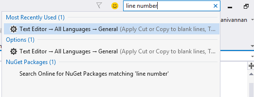
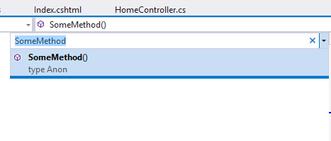
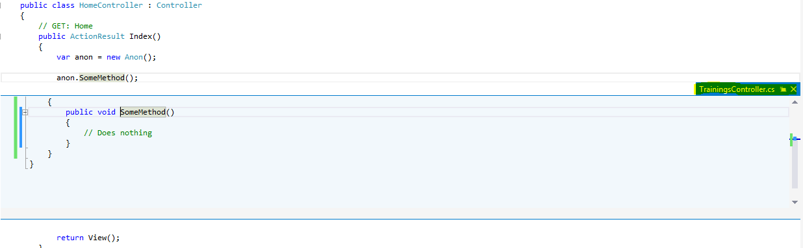
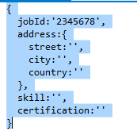
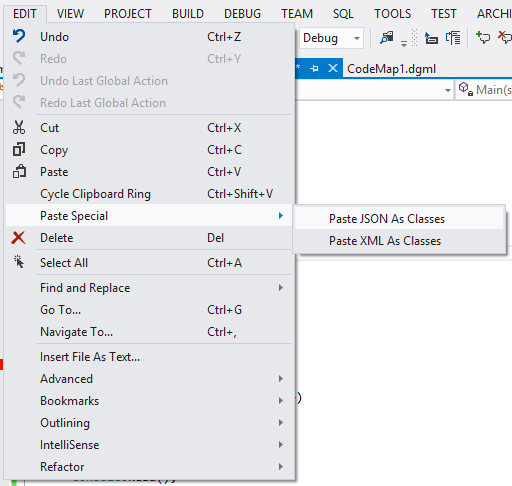

# Introduction

For anyone doing .NET development knows that Visual Studio is hands down the best IDE that we can get. but the problem is it’s such a massive tool that most developers hardly scratch the surface when it comes to its capabilities.

So here i have listed some of the tips/tricks that i think would be helpful for the developers.

## Quick Launch

-   Allows you to navigate to any feature by just typing it in.
-   Located upper right hand corner of the IDE or you can always just press Ctrl+Q.

### For example:

-   If you want to enable or disable line number usually we will go to Tools-> Options -> Text editor -> General
-   Using Quick Launch you can just type in line number and you will possible options that you can navigate to

**This saves us lot of time by avoiding to go through each menus to find some options.**

## Navigate To Window

-   You can get to this by Ctrl+,
-   This is similar to quick launch but instead of finding something within visual studio itself you are going to look for something within codebase.

Note: If you are using Resharper it also has a similar feature.

## Peek feature

-   When we press F12 on a method call Visual Studio will take us to the class file in which the method has been defined. This is great for navigation.
-   VS2012 has simplified this further by when pressing Alt+F12 instead of taking us to the target file it brings the method code to the current file which you can edit and save if you need.
-   For example in below snapshot you can see HomeController.cs is a class file which calls the SomeMethod() in TraningsController class which is in a file called TraningsController.cs.
-   When pressing Alt+F12 visual studio brings the definition of the method to the HomeController itself and allows you to make a change.

This will also support nested peek if method SomeMethod calls another method you can go to that method by pressing Alt+F12 in the minimum window.

## Debugging

-   This is most commonly used trick. While debugging Visual Studio will allows us to skip through some code if drag the debug pointer up and down.
-   We can also use this  feature to debug some reapeatedly without having to restart the application

## Paste Special

-   At some point of time in every project we will need to convert an json or xml content as serializable classes.
-   Usally developers will use some kind of tools like xsd.exe to generate C# classes from xml files etc.
-   Visual studio has this feature inbuilt so we dont have to need any extra tools.

Lets consider we have a json text like below

-   Just copy the content Go to Edit -> Paste Special -> Paste json as Classes. You will get the code for classes as shown below

## Find file in solution explorer

If you want to locate the current file in solution explorer it could be a daunting task to manually exploring the solution explorer especially if you’re project is large. To do this quickly just press Ctrl+\[+S

## Bookmarks

We can use bookmarks to mark lines in our code so that we can quickly return to a specific location and jump back and forth between locations.

-   To create a bookmark press Ctrl+K, Ctrl+K
-   To go to next bookmark press Ctrl+K, Ctrl+N
-   To go to previous bookmark press Ctrl+K,Ctrl+P
-   To View all bookmarks press Ctrl+K, Ctrl+W or go to View=>Bookmarks window
