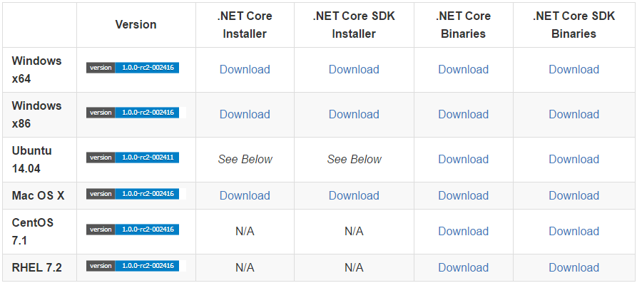
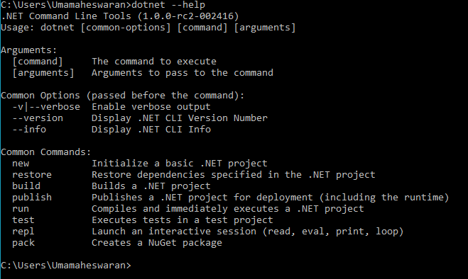
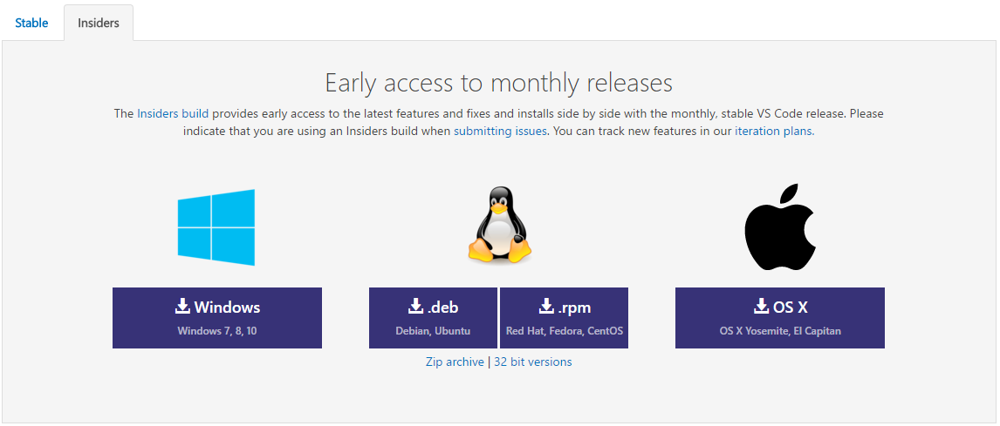
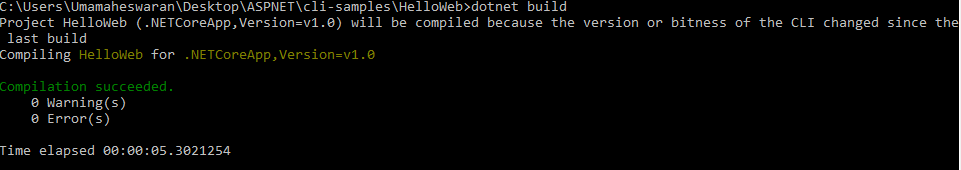
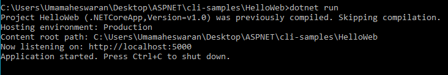
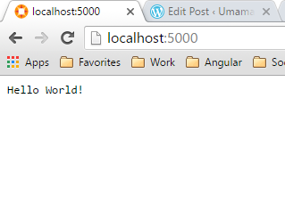
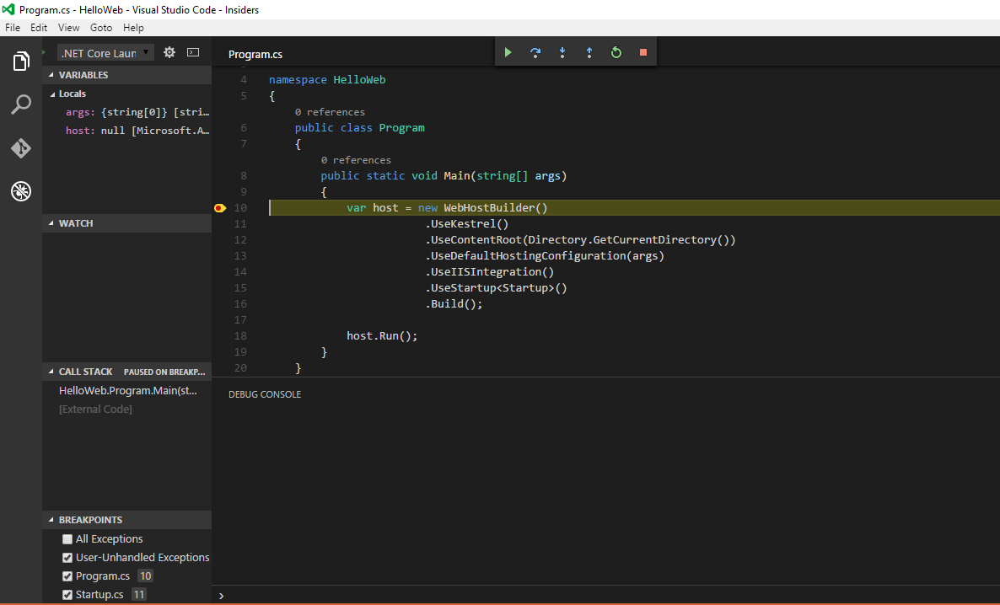

# Introduction

If you are a developer in Windows ecosystem you probably know and love .NET for its attractive features. We know .Net makes it easier to efficiently build high-quality apps. But one problem with .Net was it was not a goto technology for a open source developers since .Net was never aimed to support multiple platforms. Even though projects like MONO existed it never caught up to the Main Stream .Net developers.

But with the introduction of [.NET Core](https://dotnet.github.io/) which is cross platform implementation of .Net arrives to change it all. The main goal of this project is to create a modular, performant and cross-platform execution environment for modern applications.

In this post I will show you a start up primer for dotnet core cli

# Install DOTNET CLI

Go to dotnet github [page](https://github.com/dotnet/cli) and scroll down to [Installers and Binaries](https://github.com/dotnet/cli#installers-and-binaries)

You will then see this matrix of binaries

As you can see you will installer for most of the popular OS. For this exercise i will download .NET Core SDK Installer for Windows x64

Download the package and install the SDK. by default the package will install in the path C:\\Program Files\\dotnet. You have to add this path to the PATH env variable

Once you installed open command prompt and type dotnet –help you should see the command line options for dotnet

# Setting up develop Environment

For this exercise I’m going to use Visual Code which is a open source editor which supports several languages. You can alternatively use Visual Studio 2015 Community edition. But I will stick to Visual Code since it is a light weight editor which gets the job done.

Go to Visual Code Download [page](https://code.visualstudio.com/Download)

At the time of writing this blog Visual Code stable edition does not support debugging for dotnet core apps.But we can download Visual Code insiders preview build which has the support, I think this will supported in the stable version in May 2016 release

Download and install Insiders preview build and you are all set to develop a fully cross platform dotnot core app.

Now unlike Visual Studio, Visual Code does not comes with built in support of C# we have install an extension separately. To install

Go to https://github.com/OmniSharp/omnisharp-vscode/releases

Download latest build

Open Visual Code insiders

Go to File->Open. Choose downloaded vsix file and click Open

Then the C# plugin will get installed automatically

# Download Sample Code

To get started quickly im going to download and use sample code provided by aspnet team

Open your command prompt\[In other platform you can open the respective terminal\]

Create a new folder for the project

> mkdir aspnet
> 
> cd aspnet
> 
> git clone [https://github.com/aspnet/cli-samples.git](https://github.com/aspnet/cli-samples.git)

Once clone completed go to one of the downloaded source code

> cd cli-samples
> 
> cd helloweb

now to install the dependencies enter the below command

> dotnet restore

Once restore is done build the project using following command

> dotnet build

Now run the project using following command

> dotnet run

Now browse [http://localhost:5000/](http://localhost:5000/) you see that the web app is running

# Debug the application

Let us see if we can run the application and debug it.

Open Visual Code

Go to File>Open Folder

Open the HelloWeb project directory

Once you opened the folder you will see Visual Code downloads the debugger automatically

Once it downloaded set a debug point in Program.cs press F5 you should see a that it hit the break point

Now you are all set to create your first .Net Core app
