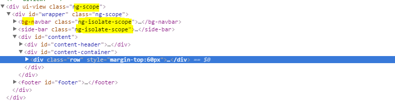

# Introduction

Angular is a powerful framework which gained lot of traction in the client side development in recent years and it is fun to work with. There are lot of things I like about Angular JS. Below are my most favorites

-   Declarative Syntax
-   SPA out of the box
-   Testability
-   Dependency Injection

Recently I learned one trick which could potentially improve the Angular JS performance and I’m sharing this with you all.

# Debug Data

When you are using AngularJS if you are inspecting elements in the DOM you might have seen some additional tags and classes in your DOM if you have paid attention closely.



Apparently these attributes are used by AngularJS to attach some information about binding and scopes to DOM nodes, and adds CSS classes to elements. Angular JS does this to help testing tools like [Protractor](http://www.protractortest.org/#/) and [Batarang](https://github.com/angular/batarang).

But when we deploy our application to production we dont need these additional debug data so we can disable it.

# Disabling Debug Data

You can disable this debug data with one line of code.

```javascript
angular
 .module('app')
 .config(function ($compileProvider) {
     $compileProvider.debugInfoEnabled(false);
 });
```

# Summary

Even though this information is present in the official **Angular JS** documentation it looks like this feature is not used much. I hope this helps someone.
