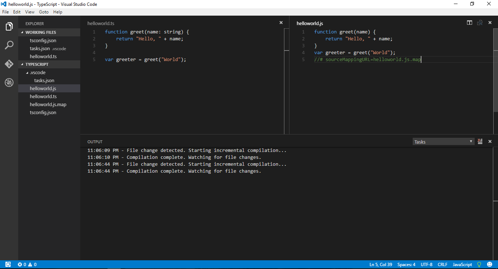

## Introduction

Typescript is a open sourced programming language developed by Microsoft. It is a Superset of Javascript and it compiles down to plain Javascript.

Typescript offers support for the latest and evolving Javascript features including ECMAScript2015 and future proposals like async.

## Why Typescript?

Typescript provides a way to add **optional** static typing to our Javascript code.

It makes is possible to use future Javascript editions in the current Javascript engines.

## Why typing?

Before going into typings we should remember that types are completely optional in Typescript.

One of the main advantage of statically typed languages are they provide great tooling during development process like static checking, compile time errors, code refactoring.

Types can enhance code quality and understandability.

## All Javascript are Typescript!!

Typescript provides compile time type checking for your javascript code. but it does so in a less intrusive way. Since types are optional even though if there are any error related to types in your code Typescript will go ahead and generate the equivalent JavaScript code irrespective of the typing errors.

So to get started with typescript all you need to do is rename all your .js file to .ts file

## Getting Started

Lets get started by installing the node package by using command below

**\>npm install typescript -g**

Note: If you are Visual Studio 2015 and Visual Studio 2013 update 2 typescript works by default otherwise you can install it from Extensions

You can pick the editor of your choice, but I’m choosing Visual Code editor since it is Open Source and offers great support for typescript.

Inside your project directory create a file called helloworld.ts and include the below content.

```javascript
function greet(name: string) {
return &amp;quot;Hello, &amp;quot; + name;
}

var greeter = greet(&amp;quot;World&amp;quot;);
```

Create a tsconfig.json file in the root directory

```javascript
{
&amp;quot;compilerOptions&amp;quot;: {
&amp;quot;target&amp;quot;: &amp;quot;es5&amp;quot;,
&amp;quot;module&amp;quot;: &amp;quot;commonjs&amp;quot;,
&amp;quot;sourceMap&amp;quot;: true
}
}
```

The presence of tsconfig.json file indicates typescript that the directory is the root of a TypeScript project

Now lets add task.json file to make the editor build typescript files automatically

Create a task.json file under .vscode directory

```javascript
{
// See https://go.microsoft.com/fwlink/?LinkId=733558
// for the documentation about the tasks.json format
&amp;quot;version&amp;quot;: &amp;quot;0.1.0&amp;quot;,
&amp;quot;command&amp;quot;: &amp;quot;tsc&amp;quot;,
&amp;quot;isShellCommand&amp;quot;: true,
&amp;quot;args&amp;quot;: [&amp;quot;-w&amp;quot;, &amp;quot;-p&amp;quot;, &amp;quot;.&amp;quot;],
&amp;quot;showOutput&amp;quot;: &amp;quot;silent&amp;quot;,
&amp;quot;isWatching&amp;quot;: true,
&amp;quot;problemMatcher&amp;quot;: &amp;quot;$tsc-watch&amp;quot;
}
```

now if you press Ctrl+Shift+B the editor will automatically create .js files for each ts files and it will continue to watch for changes in the project directory



## Conclusion

In this section we have seen the design goals of TypeScript and to setup a development env. We will dig deeper in the upcoming blogs.

All the coding that will be done in this series of blogs can be found [here](https://github.com/Umamaheswaran1990/LearningTypescript)
