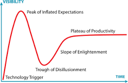

As software developers we often try to follow what is new/hot trend in programming. By doing this we would end up using technologies without fully understanding the pros and cons.  The Hype Cycle was developed by Gartner, an IT research and advisory firm. It is a useful tool for assessing the progress of new techniques and technologies.

The Hype Cycle can explain software developers attitudes toward new techniques and technologies

The x-axis of the graph represents time and y-axis represents expectation.

Initially there is a trigger, which could be a new technology  or a new technique or procedure.

Soon thereafter, expectations rise rapidly until they hit the “Peak of inflated expectations” At this point the technology or technique is viewed as a less all-powerful than was initially perceived.

This causes expectations to plummet rapidly to the “trough of dis-illusionment.”

However because the “Slope of enlightenment” gradually leads to a “plateau of productivity”. At this point  the technology or technique  is established and has more realistic expectations attached to it.
