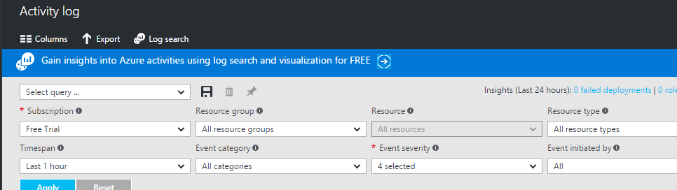
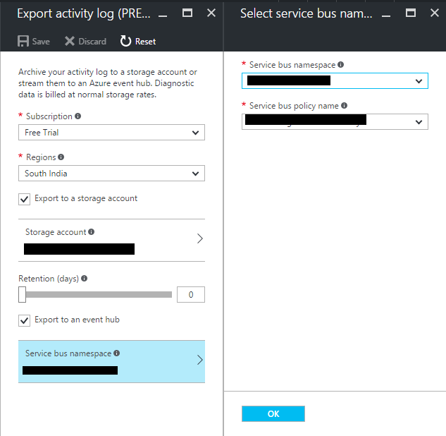
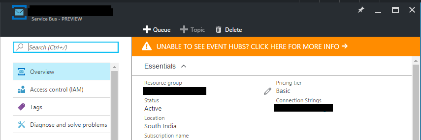
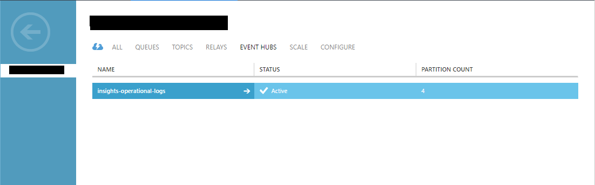

Azure

Introduction

In this blog we are going to see how to stream activity logs of your azure subscription to a Event Hub.

1.  First create a service bus name since this is required to export the Activity Log
2.  Go to Activity Logs page and click Export
3.  Enter the service bus name and policy
4.  Once the Export is done if you go to service bus resource you will not be able to see the event hubs since the new portal does not support that yet
5.  To view the event hub that is created  you need to go to the old portal
6.  In the old portal you should see the event hub with name ‘insights-operational-logs’

Conclusion

Once you create the event event you should be able to access it from other application using the proper connection string
