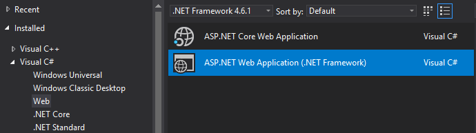
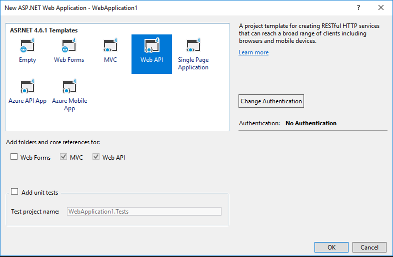
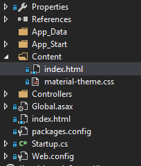
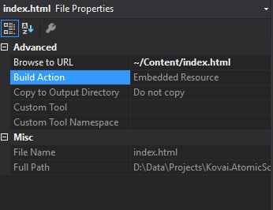
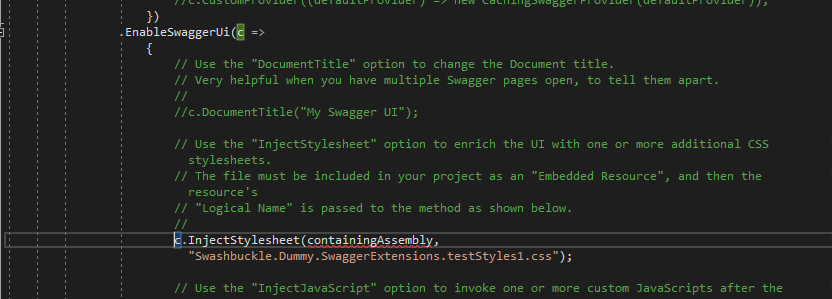
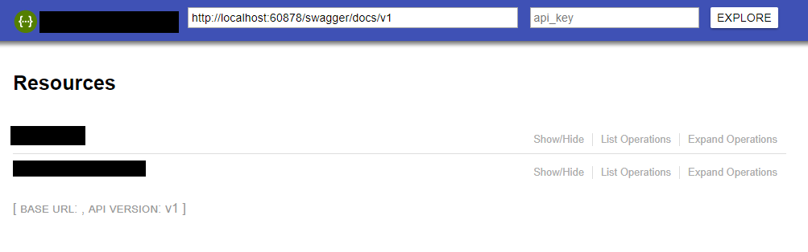

Documentation is one of the most important thing to any WEB API. That is going to be the single point of reference for the developers who are going to consume your APIs. An API with bad documentation is never going to get popular among developers. If creating documentation is one tedious process maintaining the documentation is completely different nightmare until now. So here comes the swagger as the savior for the above problems.

## What is swagger?

Swagger is one of the most popular API tooling. It helps the developers to design, build and document their API using a swagger definition file.

And that’s not all…

Once you have described your API in a swagger, you’ve opened a treasure chest full of swagger based tools including client generator tools which you can use to generated consumer/client application in a variety of platforms.

Cool. But how can I use it in my ASP.NET WEB API? Noworries! it’s as simple as adding a NuGet package called Swashbuckle to you project.

## Create new project

-   Open Visual Studio, If you don’t have one you should go and [download](https://www.visualstudio.com/) now. After all the Visual Studio community edition is free of cost.
-   Once opened Click File->New->New Project  
    
    ### 
    
-   Select ASP.NET Web Application (.NET Framework) and click Ok  
    
    ### 
    
-   Then Select Web API Template and click Ok.

Import Swashbuckle

-   Open the Nuget Package manager for the project
-   And browse for the package “Swashbuckle” and install the package. If you are using ASP.NET Core then you need to install Swashbuckle.AspNetCore
-   Start the Web API
-   Now if you browse to _**<your-root-url>/swagger**_ you should see the swagger documentation like below

## Customizing the UI

The UI isn’t bad but sometimes you may want to customize things like including your company name changing font & colors etc. The good thing about the Swashbuckle is it has few extension points that we can use to customize the look and feel.

If you open SwaggerConfig.cs file under App\_Start folder you can see that all the configuration that is related to the swagger is present.

Things you can customize in Swashbuckle

-   Stylesheet
-   Javascript
-   HTML
-   Submit methods, Boolean values, etc

### Customizing index.html

You can inject your own index.html using this [template.](https://github.com/domaindrivendev/Swashbuckle/blob/v5.5.3/Swashbuckle.Core/SwaggerUi/CustomAssets/index.html) Using this you can customize things like editing your company name removing things like api\_key input and explore buttons.

-   To do this first you need add an index.html to your project under Content.  
    
    ### 
    
-   In Solution Explorer, right click the file and open its properties window. Change the “Build Action” to “Embedded Resource”  
    
    ### 
    

Once this is done you can open SwaggerConfig.cs and search for EnableSwaggerUi under that you can uncomment line starts with c.CustomAsset(“index”, and you need to change the parameters based on your project. For example if you project name is ECommerce and you have placed the index.html under Content folder. The line should look like below

```csharp
c.CustomAsset("index", thisAssembly, "ECommerce.Content.index.html");
```

### 

To customize the styles you can visit this [github](https://github.com/ostranme/swagger-ui-themes) project and get any css files based on your liking and add them to the project same as you did with index.html.

Once the CSS is added and it is made as an embedded resource. You should edit the SwaggerConfig.cs again like below

```csharp
c.InjectStylesheet(thisAssembly, "ECommerce.Content.material-theme.css");
```

Once you done this your swagger UI should look like below

### 

Please visit the office github [link](https://github.com/domaindrivendev/Swashbuckle/tree/v5.5.3) to know more about swashbuckle

Happy coding!!
