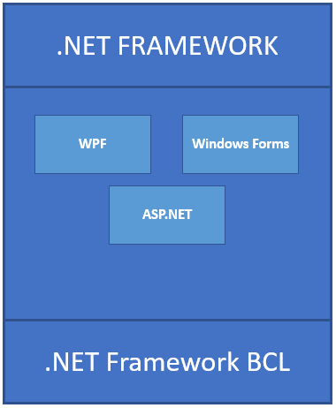
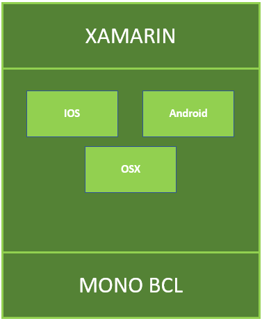
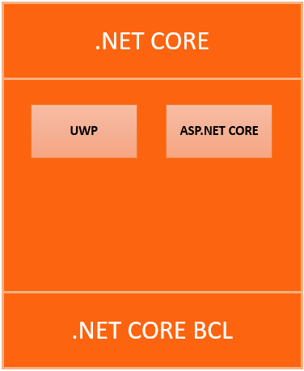
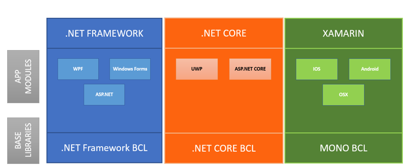
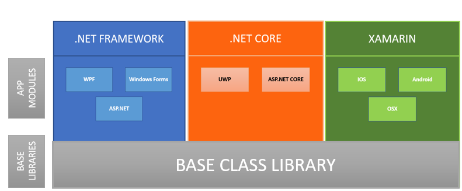

If you are .NET developer before 5 years life was simple. If someone asked you what is your domain you would reply “I’m a .NET developer”. It’s not the case anymore. Now we have several .NET and its kind of confusing for any new developers to come in to .NET landscape and pick one.

## Background

Initially we had only this .NET Framework. Which is kind of a bigger framework and it allows us to create mobile apps, desktop apps and web apps that run only on Windows PCs, devices and servers

And then around 2011 we had XAMARIN which kind of brought the power and productivity of .NET to iOS and Andriod by reusing skills and code while giving access to the native APIs and performance. But it was going on in a different track till Microsoft acquired XAMARIN on 2016.

And then we have the new .NET  Core which gives you a blazing fast and modular platform for creating server application that run on Windows, Linux and Mac.

So we have all these platforms and different app models like WPF, ASP.NET, IOS, Android etc. that kind of makes sense since some run on web and sum run mobile etc, but when we look at the Base Class Libraries(BCL) for us developers doesn’t not make any sense at all. Since we will be using these base libraries to develop our applications.

So what are all the problems with this

-   Difficult to reuse skills
    -   Need to master all 2 base class libraries
-   Difficult to reuse code
    -   Need to target a fairly small common denominator
-   Difficult to innovate
    -   We need implementation on each platform

And this is where .NET Standard come in. The Idea is that there are places where it makes sense to have different app models running in different places doing different things However the Standard Base Library should be common. So the Idea is to take all the stuff thats there in each of these frameworks and put it all into one single container called .NET Standard.

## What exactly is a .NET Standard?

.NET Standard is just a specification. It’s not something that you would install along with other .NET frameworks. It’s basically a set of APIs that all .NET platform have to implement.

To put this in a better context let me explain it from a web developer perspective. Lets take HTML specification, It’s designed by W3C and all browsers like Chrome, Edge, Firefox etc has to implement in their respective browsers.

.NET Standard current version is 2.0 and it has support 20K more APIs than .NET standard 1.x. And already 70% of Nuget packages are .NET standard complaint.

If you already have a .NET Library published in Nuget and if you haven’t migrated to .NET Standard don’t worry! You library will be still be accessible to developers who are doing .NET Standard and you don’t have to recompile your dll or anything.

## Conclusion

If you are .NET developer For all your new projects I think we should start developing against .Net Standard while Microsoft works on unifying the different BCL libraries at the background.

Please stay tuned for more .net core stuff. You can also check out my [article](/2016/09/03/how-to-create-dotnet-console-application-in-3-steps/) on how to create dotnet console application in 3 steps.
