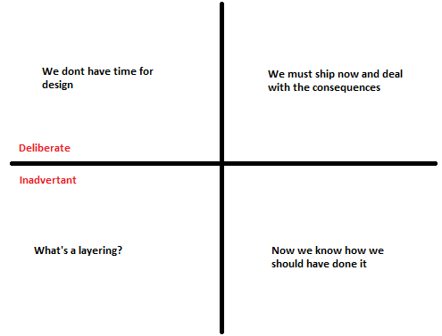

Whenever we develop a software feature, it is likely that certain compromises will need to be made  between the “ideal code” and the code that is good enough to meet the deadline. This is not to say that poor design should be encouraged to meet the deadline, but that there is some value in doing something simpler now, with a view point of improving it later.

It’s all about trade-off. You could implement a sub optimal solution now and meet a deadline or spend the extra time now to improve the design, perhaps missing the deadline. There is no right answer that fits all situations, just guidelines for detecting good and bad technical debt.

[**Martin Fowler**](https://martinfowler.com/aboutMe.html) has proposed a solution to identify whether a technical debt is good or bad using a concept called Technical Debt Quadrant. his method mainly focuses on these two questions.

-   Is it a valid technical debt?
-   Is there a way to avoid this technical debt?

Based on the above questions you can have quadrant with 4 possible scenarios

**Reckless, deliberate** – This type of debt is the most poisonous. It is equivalent to saying something like, “We don’t have time to design,” which indicates a very unhealthy working environment. A decision such as this should alert everyone that the team is not adapting, and is marching steadily toward inevitable failure.

**Reckless, Inadvertent** This type of debt is most likely created by a lack of experience. It is the result of not knowing best practices in modern software engineering. it is likely that the code is a mess, much like in the previous  case, but the developer did not know any better and therefore could not find any other options. Education is the answer here: as long as developers are willing to learn, they can stop introducing this kind of technical debt.

**Prudent, inadvertent** This occurs when you follow best practices but it turns out that there was a better way of doing something, and “now you know how you should have done it.” This is similar to the previous case, but all of the developers were in agreement at the time that there was no better way of solving this problem.

**Prudent, deliberate** This is the most acceptable type of debt . All of the choices has been considered, and you know exactly what you are doing and why. By allowing this debt to remain. It is most commonly associated with a late decision  to “ship now and deal with the consequences”

## Repaying Debt

Technical debt is not directly associated with any story points, yet the debt must be repaid despite the lack of direct incentive . It is best to try to attach a technical debt card to a story and refactor the code so that the new design is implemented along with associated new behavior. The next time the story is taken from the board, check whether any of the code that will be edited has a technical debt attached, and try to tackle the two together.

**Reference: Adaptive Code Via C#**
