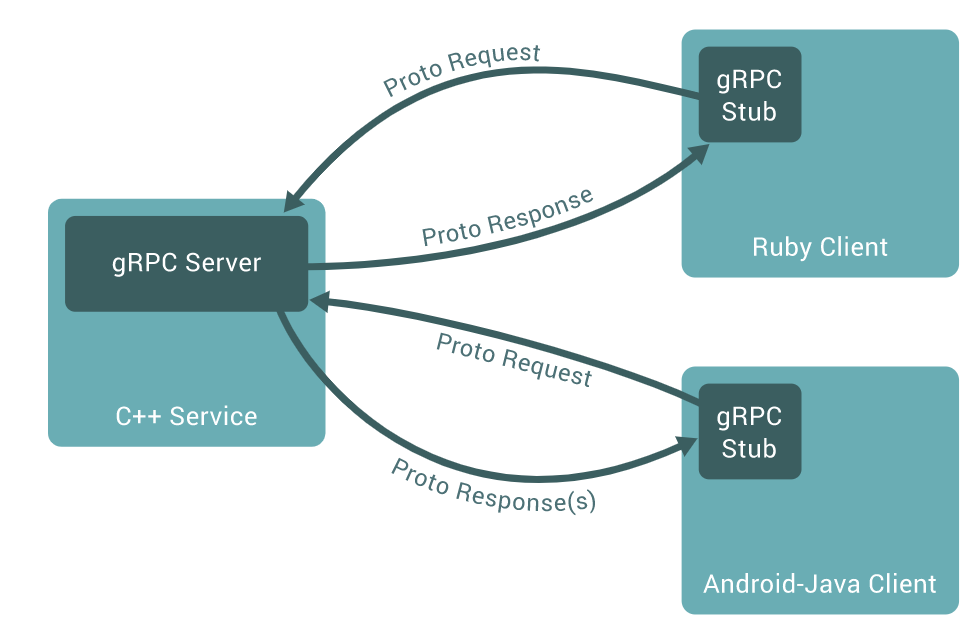
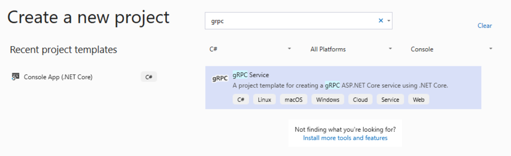
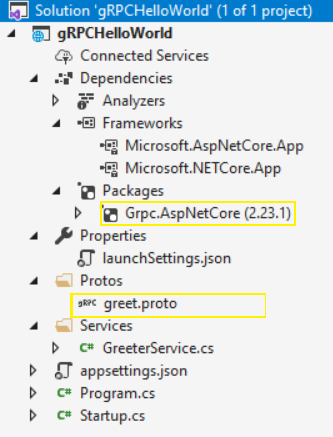

At this point most of you might have already came across this term called “gRPC”. gRPC is a modern open source high performance RPC framework that can run in any environment. Which makes it suitable for building micro services.

Personally, I’d been intrigued by gRPC and its potential to completely change how we are building the API’s today.

> “Once a new technology rolls over you, if you’re not part of the steamroller, you’re part of the road.”
> 
> Stewart Brand, Writer

## REST

REST is by far the most popular way of building web apis. Since it’s easy to understand, and the fact that it uses existing HTTP infrastructure made it easy for developers to build APIs using the high quality HTTP implementation that is available in every language.

But one of the biggest problem with REST is that there is no formal API contract. REST is is not a silver bullet. Sometimes you would want an RPC-style service where the operations are too difficult to model.

## What’s gRPC

gRPC is a free and open-source framework developed by Google. gRPC is part of the Cloud Native Computation Foundation like Docker & Kubernetes for example.

At a high level, it allows you to define REQUEST and RESPONSE for RPC and handles all the rest for you. On top of it, it’s modern, fast and efficient, build on top of HTTP/2, low latency, supports streaming, language independent and makes it super easy to plug in authentication, load balancing, logging and monitoring.

### What’s an RPC?

An RPC is a Remote Procedure Call. In your CLIENT code, it looks like you’re just calling  a function directly on the SERVER. However RPC is not a new concept(CORBA) had this before. With gRPC, it’s implemented very cleanly and solves a lot of problems.



If you want to learn more about the internals of the gRPC please visit [grpc.io](https://grpc.io/).

Okay that’s all fine what are all the languages that supports gRPC. At the time of writing this article its supported in about 11 languages which covers most of the popular languages like Java, Python, JavaScript and ofcourse C#.

## gRPC using C#

gRPC uses a contract-first approach to API development. Services and messages are defined in \*.proto files.

Lets get started by creating a new project in Visual Studio.



Once you created the project expand the solution explorer and explore the solution structure. It doesn’t look that different from a regular ASP.NET Core Service except few items



In the solution explorer you can see that the packages section has a package Grpc.AspNetCore

Also we have a greet.proto file. These proto files are used to define services and messages

```csharp
syntax = "proto3";

service Greeter {
  rpc SayHello (HelloRequest) returns (HelloReply);
}

message HelloRequest {
  string name = 1;
}

message HelloReply {
  string message = 1;
}
```

Wait a sec!! Now why does that look familiar. If you have worked on WSDL you would see this and realize that this is not that different. Infact you can consider gRPC as a better version of SOAP.

.NET types for services, clients and messages are automatically generated by including \*.proto files in a project.

### gRPC services on ASP.NET Core

gRPC services can be hosted on ASP.NET Core. Services have full integration with popular ASP.NET Core features such as logging, dependency injection(DI), authentication and authorization.

The gRPC service project template provides a starter service

```csharp
 public class GreeterService : Greeter.GreeterBase
    {
        private readonly ILogger<GreeterService> _logger;
        public GreeterService(ILogger<GreeterService> logger)
        {
            _logger = logger;
        }

        public override Task<HelloReply> SayHello(HelloRequest request, ServerCallContext context)
        {
            return Task.FromResult(new HelloReply
            {
                Message = "Hello " + request.Name
            });
        }
    }
```

GreeterService inherits from the GreeterBase type, which is generated from the Greeter service in the \*.proto file. The service is made accessible to clients in Startup.cs:

```csharp
app.UseEndpoints(endpoints =>
{
    endpoints.MapGrpcService<GreeterService>();
});
```

### gRPC Client

To consume the gRPC service that was created as default by Visual Studio lets create a .Net Core Console application to consume it

Once you created the .Net Core Console application. Install the following packages

```powershell
Install-Package Grpc.Net.Client
Install-Package Google.Protobuf
Install-Package Grpc.Tools
```

#### Add greet.proto

Create a Protos folder in the gRPC client project

Copy the Protos\\greet.proto file from the gRPC Greeter service to the gRPC client project.

Edit the client project \*.csproj file

Add an item group with a <ProtoBuf> element that refers to the greet.proto file

```xml
<ItemGroup>
  <Protobuf Include="Protos\greet.proto" GrpcServices="Client" />
</ItemGroup>
```

#### Create the greeter client

Build the project to create the types in the namespace. The types are generated automatically by the build process.

Update the gRPC client Program.cs file with the following code:

```csharp
using Grpc.Net.Client;
using System;
using System.Threading.Tasks;

namespace gRPCHelloWorld.Client
{
    class Program
    {
        static async Task Main(string[] args)
        {
            // The port number(5001) must match the port of the gRPC server.
            var channel = GrpcChannel.ForAddress("https://localhost:5001");
            var client = new Greeter.GreeterClient(channel);
            var reply = await client.SayHelloAsync(
                              new HelloRequest { Name = "GreeterClient" });
            Console.WriteLine("Greeting: " + reply.Message);
            Console.WriteLine("Press any key to exit...");
            Console.ReadKey();
        }
    }
}
```

Program.cs contains the entry point and logic for the gRPC client.

The greeter client is created by:

-   Instantiating an HttpClient containing the information for creating the connection to the gRPC service.
-   Using the HttpClient to construct a gRPC channel and the greeter client

#### Test the gRPC client

-   In the Greeter service, press Ctrl+F5 to start the server without the debugger.
-   In the Greeter Client project, Press Ctrl+F5 to start the client without the debugger

The client sends a greeting to the service with a message containing its name GreeterClient. The service sends the message “Hello GreeterClient” as a response. The “Hello GreeterClient” response is displayed in the command prompt:

```powershell
Greeting: Hello GreeterClient
Press any key to exit...
```

## Conclusion

gRPC has a lot of potential for becoming a defacto standard for building WEB APIs in near future.
