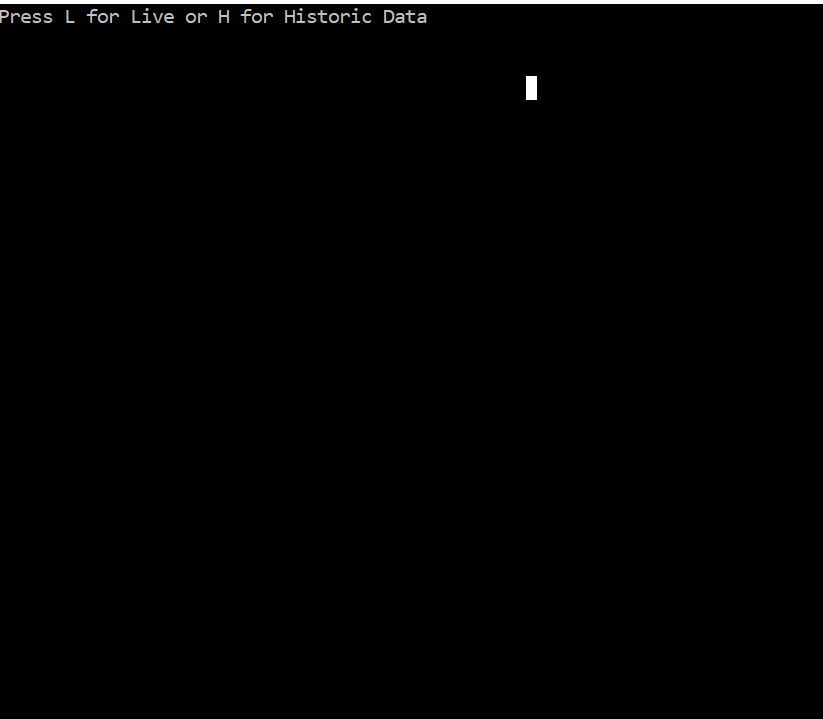

Let’s be real, processing trillions of events per day can be challenging in any kind of framework/language. The fact that you can do this using the language that you know, and love can be really tempting.

In my previous job I have worked on a project for handling thousands of business events, in addition to storing the events we wanted the ability to search those events and create analytics for those events. Which can be very challenging especially when you want to scale out to millions/billion events per day.

## What is Trill?

Trill is a high performance one pass, in-memory streaming analytics engine. It can handle both real-time and offline data and is based on a temporal data and query model. Trill can be used as a streaming engine or a lightweight in-memory relational engine and as a progressive query processor or early query results on partial data.

Internally trill has been used by developers working on **Azure Stream Analytics**, **Bing ads** and even **Halo**.

So seeing this go open source is really incredible!!

## How to get started?

Trill is a single-node engine library, any .NET application, service or platform can easily use Trill and start processing queries.

Let’s see some code

```csharp
IStreamable<Empty, SensorReading> inputStream;
```

This is the primary interface for creating streamable operations

Some sample for creating an input stream.

```csharp
private static IObservable < SensorReading > SimulateLiveData() {
 return ToObservableInterval(HistoricData, TimeSpan.FromMilliseconds(1000));
}

private static IObservable < T > ToObservableInterval < T > (IEnumerable < T > source, TimeSpan period) {
 return Observable.Using(
  source.GetEnumerator,
  it => Observable.Generate(
   default (object),
   _ => it.MoveNext(),
   _ => _,
   _ => {
    Console.WriteLine("Input {0}", it.Current);
    return it.Current;
   },
   _ => period));
}

private static IStreamable < Empty, SensorReading > CreateStream(bool isRealTime) {
 if (isRealTime) {
  return SimulateLiveData()
   .Select(r => StreamEvent.CreateInterval(r.Time, r.Time + 1, r))
   .ToStreamable();
 }

 return HistoricData
  .ToObservable()
  .Select(r => StreamEvent.CreateInterval(r.Time, r.Time + 1, r))
  .ToStreamable();
}
```

Now that we have a stream of events let’s try to add some logic to validate the events. We need to write a query to detect when a threshold is crossed upwards.

```csharp
// The query is detecting when a threshold is crossed upwards.
const int threshold = 42;

var crossedThreshold = inputStream.Multicast(
 input => {
  // Alter all events 1 sec in the future.
  var alteredForward = input.AlterEventLifetime(s => s + 1, 1);

  // Compare each event that occurs at input with the previous event.
  // Note that, this one works for strictly ordered, strictly (e.g 1 sec) regular streams.
  var filteredInputStream = input.Where(s => s.Value > threshold);
  var filteredAlteredStream = alteredForward.Where(s => s.Value < threshold);
  return filteredInputStream.Join(
   filteredAlteredStream,
   (evt, prev) => new {
    evt.Time, Low = prev.Value, High = evt.Value
   });
 });
```

That’s it, now you can just listen to the crossedThreshold event and print the value whether the event occurs.

In the output below you can see that when the threshold is crossed it is being captured and printed at the end.



## Conclusion

The best part about Trill is it’s just a library. So it will run within a process on any computer but can spawn multiple threads for parallel processing if configured to do so. To span multiple nodes you can use [Orleans](http://research.microsoft.com/en-us/projects/orleans/) or [Azure Stream Analytics](https://azure.microsoft.com/en-in/services/stream-analytics/) etc.

## Resources

-   [Announcement blog post](https://azure.microsoft.com/en-in/blog/microsoft-open-sources-trill-to-deliver-insights-on-a-trillion-events-a-day/)
-   [Trill Source Code](https://github.com/microsoft/Trill)
-   [Trill Samples](https://github.com/Microsoft/TrillSamples)
