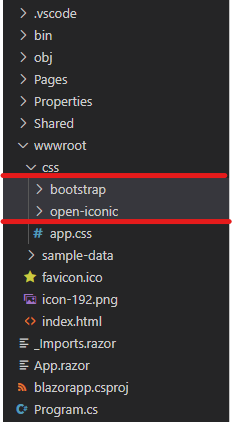
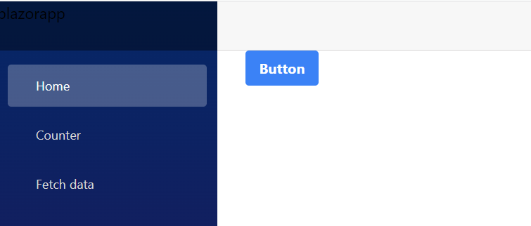

[Blazor](https://dotnet.microsoft.com/en-us/apps/aspnet/web-apps/blazor) lets you build web UI components with C# dotnet. These components can be used in browser via web assembly or server side via ASP.NET Core.

[Tailwind CSS](https://tailwindcss.com/) is utility-based CSS framework. Unlike bootstrap Tailwind doesn’t come with its own components, it has thousands of micro-CSS classes which can be used to build our UI components based on our design needs.

Let’s see how to get started with Tailwind CSS in blazor applications

## Create & Clean

First create a blazor application using the following command

```powershell
dotnet new blazorwasm
```

After creating the blazor application remove the bootstrap bits by following below steps



-   In the source code under `wwwroot/css/` delete `bootstrap` and `open-iconic` folders
-   Open `app.css` and remove all css upto `#blazor-error-ui` from the beginning
-   Open `index.html` and remove the reference to the bootstrap `<link href="css/bootstrap/bootstrap.min.css" rel="stylesheet" />`

## Setup

-   In the root folder of you Blazor application, run `npm init --yes` to initialize a `package.json`.
-   Next run `npm install -D tailwindcss postcss-import`.
-   Next run `npx tailwindcss init --postcss` which will create `tailwind.config.js` and `postcss.config.js` files

Once the files are created update the `tailwind.config.js` file to watch certain files and ignore some folders.

```javascript
module.exports = {
  content: [
    '!**/{bin,obj,node_modules}/**',
    '**/*.{razor,html}',
  ],
  theme: {
    extend: {},
  },
  plugins: [],
}
```

Update the `postcss.config.js` file to below. This is required to `@import` any CSS in `{proj_name}.styles.css`

```javascript
module.exports = {
  plugins: {
    'postcss-import': {},
    tailwindcss: {}
  }
};
```

Create a new css files in root as `site.css` and the following code

```css
@import "tailwindcss/base";
@import "tailwindcss/components";
@import "tailwindcss/utilities";
```

## Build & Watch

In the `package.json` enter the following code for scripts property

```javascript
  "scripts": {
    "build": "npx tailwindcss --config tailwind.config.js --postcss postcss.config.js -i site.css -o ./wwwroot/site.min.css",
    "watch": "npx tailwindcss --config tailwind.config.js --postcss postcss.config.js -i site.css -o ./wwwroot/site.min.css --watch",
    "publish": "npx tailwindcss --config tailwind.config.js --postcss postcss.config.js -i site.css -o ./wwwroot/site.min.css --minify"
  }
```

Now if you try running `npm build` you could see the `site.min.css` getting created.

Now refer to the `site.min.css` in your `index.html`.

Open site.css in your root folder and add the code below.

```css
@import "tailwindcss/base";
@import "tailwindcss/components";
@import "tailwindcss/utilities";

@layer base{
    .btn {
        @apply font-bold py-2 px-4 rounded;
      }
      .btn-blue {
        @apply bg-blue-500 text-white;
      }
      .btn-blue:hover {
        @apply bg-blue-700;
      }
}
```

Once the above is done open your Index.razor file and update the code as below.

```xml
@page "/"

<PageTitle>Index</PageTitle>

<button class="btn btn-blue">
  Button
</button>
```

Now run the `npm build` command and then run `dotnet watch` and you can see that the button is now styled using tailwind css



Now that you have done the setup if you want to automate the build checkout this [link](https://www.tailblazor.dev/build#targets).

**Reference**

[https://www.tailblazor.dev/](https://www.tailblazor.dev/)
