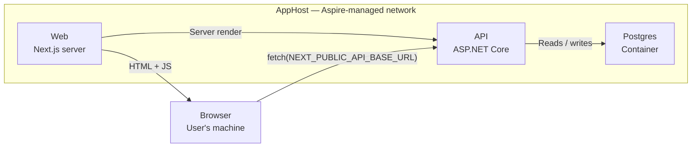

## Next.js Under Aspire

Aspire will happily start your Next.js dev server. Getting the port, the API origin, and the published image right is where the real work is.

| Component | Version |
| --- | --- |
| Aspire | 13.4.6 |
| Next.js | 16.3.1 |
| .NET | 10 |
| Published | August 2026 |

The pitch for putting a Next.js app under a .NET Aspire AppHost is not that Aspire runs `next dev`—you can do that in a second terminal. The pitch is that the frontend stops being a thing you start separately and configure by hand. One `dotnet run` provisions Postgres, applies migrations, starts the API, waits for it to report healthy, and only then starts Next with the API’s real URL already in its environment. No `.env.local` with a port you copied out of a log line last Tuesday.

That’s the good version. The version most people get on the first try starts Next on the wrong port, points the browser at nothing, and produces a container image that talks to `localhost` in production. Here is what actually has to be true.

## The Four Lines That Wire It Up

Add the hosting package to the AppHost project, then declare the app. Aspire 13 ships a Next.js-specific resource alongside the generic JavaScript one.

**`backend/RedSpear.AppHost/RedSpear.AppHost.csproj`**

```xml
<PackageReference Include="Aspire.Hosting.JavaScript" />
```

**`AppHost.cs`**

```csharp
var api = builder.AddProject<Projects.RedSpear_Api>("api")
    .WithReference(database)
    .WaitFor(database)
    .WithHttpHealthCheck("/health")
    .WithExternalHttpEndpoints();

var web = builder.AddNextJsApp("web", "../../apps/web", "dev")
    .WaitFor(api)
    .WithEnvironment("NEXT_PUBLIC_API_BASE_URL", api.GetEndpoint("http"))
    .WithHttpEndpoint(env: "PORT", port: 3000)
    .WithExternalHttpEndpoints();
```

Four of those five calls on `web` are load-bearing in a way that isn’t obvious, so let’s take them in order of how badly they bite.

## Aspire Assigns the Port. Next Has to Obey It.

`WithHttpEndpoint(env: "PORT", port: 3000)` does two separate things:

1.  The `port` argument pins the endpoint Aspire advertises—useful when other things, such as a hosted link, embed snippet, or OAuth redirect URI, need a stable origin.
2.  The `env` argument tells Aspire to write the chosen port into a `PORT` environment variable in the child process.

Writing it is all Aspire can do. Nothing in Next.js reads `PORT` for `next dev`; it binds to port 3000 unless you pass `-p`. The other half of the contract lives in `package.json`.

**`apps/web/package.json`**

```json
{
  "scripts": {
    "dev": "next dev -p ${PORT:-3000}",
    "start": "next start -p ${PORT:-3000}"
  }
}
```

The `${PORT:-3000}` default matters: it keeps a bare `npm run dev` working for anyone who doesn’t want to boot the whole AppHost.

### Why This One Is Nasty

If you omit `-p`, everything looks fine. Aspire picks a free port, marks the resource as running, and shows you a link. Next is listening on port 3000, which nobody told Aspire about. The dashboard link returns a 404 or—worse, if port 3000 happens to hold something else—silently serves a different app. There is no error anywhere. Pin the port and read it in the script.

## The Browser Is Outside the Graph

This is the part that trips up people coming from a pure .NET Aspire background, where `WithReference` is the answer to “How does A find B?”

`WithReference(api)` injects environment variables in Aspire’s service-discovery format—`services__api__http__0` and friends. The .NET service discovery libraries know how to resolve `http://api` against those. Next.js has never heard of them, and even if you taught the Node server to parse them, it wouldn’t help the part that matters: the `fetch` call running in your user’s browser, which is not on Aspire’s network at all.



The browser-to-API path leaves the AppHost’s network and comes back in. It cannot resolve `http://api`, so the API’s origin has to be handed to the browser as a literal URL.

Hence the explicit line. `api.GetEndpoint("http")` is an expression Aspire resolves once the API’s endpoint is allocated, and `WithEnvironment` writes the resulting absolute URL into the variable Next will inline:

```csharp
.WithEnvironment("NEXT_PUBLIC_API_BASE_URL", api.GetEndpoint("http"))
```

Keep `WithReference(api)` too if the Next server itself calls the API during rendering—but understand it as a second, separate channel, not the one the browser uses.

## `NEXT_PUBLIC_` Is Frozen at Build Time

This is the gotcha that survives all the way to production because it doesn’t exist in development. In dev, the value is read when the server starts, so Aspire’s injection just works. In a published build, it is inlined into the JavaScript bundle.

> **From the Next.js environment variables guide:** After being built, your app will no longer respond to changes to these environment variables. If you build and deploy a single Docker image to multiple environments, all `NEXT_PUBLIC_` variables will be frozen with the value evaluated at build time.

So a build produced on your laptop carries your laptop’s API URL into every environment it is later promoted to. If you deploy one image per environment and build with the right value, this is a non-issue. If you build once and promote—the normal thing—you need a runtime path instead.

On the App Router, that means reading the variable on the server during dynamic rendering and passing it down.

**`app/layout.tsx`—runtime, not build time**

```tsx
import { connection } from "next/server";

export default async function RootLayout({ children }) {
  await connection();
  const apiBase = process.env.API_BASE_URL;

  return <ApiConfig value={apiBase}>{children}</ApiConfig>;
}
```

Note that the variable loses its `NEXT_PUBLIC_` prefix in that version—that’s the point. It stays server-side, is read per request, and reaches the client as ordinary props. Aspire injects it exactly the same way; only the consumption changes.

## Don’t Let the Two Sides Wait on Each Other

A tempting line: the API needs to build absolute links back to the frontend—hosted pages, embed snippets, or email links—so read the frontend’s endpoint off the `web` resource.

```csharp
// Deadlock: api waits for web's endpoint; web waits for api to be healthy.
api.WithEnvironment("Api__FrontendBaseUrl", web.GetEndpoint("http"));
var web = builder.AddNextJsApp(...).WaitFor(api);
```

Aspire has to resolve the API’s environment before it can start the API, and it can’t resolve that expression until the `web` resource has an endpoint, which it won’t get until the API is healthy. Startup hangs with no useful error.

Declare the public origin as a parameter instead. It’s also the more honest model: in production, the frontend’s public origin is a custom domain, which is a deployment input—not something to discover at runtime.

```csharp
var frontendUrl = builder.AddParameter(
    "frontend-url",
    "http://localhost:3000");

api.WithEnvironment("Api__FrontendBaseUrl", frontendUrl);

var web = builder.AddNextJsApp("web", "../../apps/web")
    .WithHttpEndpoint(env: "PORT", port: 3000); // Same 3000, deliberately.
```

The pinned port and the parameter default have to agree, which is a good argument for pinning the port rather than letting Aspire choose.

> **On parameters generally:** A bare `AddParameter("x")` is required. Aspire blocks every dependent resource until someone types a value into the dashboard. For anything optional, give it an explicit default—even an empty one—or your first run appears to hang on nothing.

## `WaitFor` Is Not `WithReference`

They read similarly and do unrelated things:

-   `WithReference` is configuration plumbing. It injects connection strings and service-discovery variables.
-   `WaitFor` is a startup gate. It means “don’t launch this until that one is up.”

You usually want both, and you want the gate to mean something stronger than “the process exists”:

```csharp
.WithHttpHealthCheck("/health")
```

With a health check on the API, `WaitFor(api)` holds the frontend until the API reports ready—migrations applied and database reachable—rather than merely started. Without it, Next comes up, immediately fetches, and your first page load is an error state you then have to reload past every single morning.

## Publishing: Pick the Right Resource Type

In run mode, `AddJavaScriptApp` and `AddNextJsApp` behave much the same. In publish mode, they diverge sharply, and this is the strongest reason to use the Next-specific one.

|  | `AddJavaScriptApp` | `AddNextJsApp` |
| --- | --- | --- |
| **Publish output** | Generates a generic Dockerfile if the app directory doesn’t already contain one. | Generates a multi-stage Dockerfile built on Next’s standalone output. |
| **What ships** | The app plus whatever its package manager installs to run the start script. | Only `public/`, `.next/standalone/`, and `.next/static/`, placed into a Node runtime image. |
| **Requires** | Nothing beyond a runnable script. | `output: "standalone"` in `next.config.ts`, and a `public/` directory that exists even if it’s empty. |
| **Validation** | None. | Adds publish prerequisite checks that inspect the config for standalone output. Suppress with `DisableBuildValidation()`. |

The requirement is easy to miss because nothing complains until deploy time—and if you’re using `AddJavaScriptApp`, nothing complains at all; you just get a fatter image than you wanted. One line fixes it.

**`apps/web/next.config.ts`**

```typescript
const nextConfig: NextConfig = {
  output: "standalone",
  reactCompiler: true,
};
```

The standalone `server.js` honors `PORT` and `HOSTNAME` natively, so the port contract carries over to the published container without the `package.json` shim.

## The Other Two Shapes

Not every JavaScript app should publish as a Node server. The same package offers:

-   `PublishAsStaticWebsite(apiPath, apiTarget)`—for a Vite or Angular SPA. It builds a container running YARP that serves the static output and reverse-proxies a path prefix to a backend resource, resolved through service discovery. This is the clean answer to the CORS and API-origin problem for SPAs: same origin, no `NEXT_PUBLIC_` anything.
-   `PublishAsNodeServer(entryPoint, filesPath)`—for frameworks that emit a server artifact you run directly, such as `.output/server/index.mjs`. It changes only the runtime container shape; the build still runs through your package manager.

Package manager selection is explicit too: `AddJavaScriptApp` configures npm, while `WithPnpm()`, `WithYarn()`, or `WithBun()` switches it. This is worth setting deliberately in a monorepo, where the wrong installer produces a confusing, half-working `node_modules`.

## Keep Dev-Only Things Out of the Manifest

Aspire’s execution context tells you whether you’re running locally or generating a deployment manifest. Gate anything that shouldn’t ship:

```csharp
if (builder.ExecutionContext.IsRunMode)
{
    // A stand-in customer site, a seeded demo login, or a mock provider—
    // present locally, absent from every published manifest.
    builder.AddNextJsApp("embed-sandbox", "../../examples/embed-sandbox")
        .WaitFor(web)
        .WithHttpEndpoint(env: "PORT", port: 3300);
}
```

This mechanism lets you declare a demo account’s credentials once and hand them to both sides—the API seeds the account, while the frontend prefills the sign-in form—so the two can’t drift apart.

Don’t rely on `IsRunMode` alone for anything sensitive. Pair it with a guard on the frontend side, where `NODE_ENV` is substituted at build time and a production bundle therefore has no branch that reads the values at all.

On port choices: using port 3300 rather than 3100 or 3200 is not arbitrary. Those are common defaults for other local tooling, and a clash is quiet—the port answers, just not with your app.

## Checklist

-   Reference `Aspire.Hosting.JavaScript` in the AppHost project.
-   Use `AddNextJsApp`, not `AddJavaScriptApp`, unless you have a reason.
-   Pin the endpoint with `WithHttpEndpoint(env: "PORT", port: …)` and read `${PORT}` in the `dev` and `start` scripts.
-   Pass the API origin explicitly with `api.GetEndpoint("http")`. Service discovery does not reach the browser.
-   Decide whether the API origin is build-time or runtime. If you promote one image across environments, drop the `NEXT_PUBLIC_` prefix and read it server-side.
-   Make the frontend’s public origin a parameter; never read `web.GetEndpoint(…)` from the API.
-   Add `WithHttpHealthCheck` to the API so `WaitFor` means ready, not started.
-   Set `output: "standalone"` and keep a `public/` directory before you publish.

Get those eight right and the promise holds up: one command, a dashboard with logs and traces for the database, the API, and the frontend side by side—and a new contributor who is running the whole stack before they’ve read a word of setup documentation.
