In my [last post](/2026/10/10/from-prompting-to-understanding-llms/) I wrote about what happens after you call an LLM API: the model runs inference, predicts one token, appends it, and does the whole thing again. A 500-token answer means roughly 500 trips through the model.

Once that clicked for me, a lot of things made sense. Why responses stream in word by word. Why longer answers take longer. Why people talk so much about memory bandwidth on GPUs: every one of those trips has to read the model's weights again.

So when a paper from Stanford and Together AI showed up claiming to generate text **10–31× faster** by *not* doing that, I wanted to understand it. The paper is [Next-Concept Modeling: Fast, Parallel Coarse-to-Fine Text Generation](https://arxiv.org/abs/2610.14162) (Kumbong et al., October 2026), from Chris Ré's group.

This is my attempt to explain it the way I'd want it explained to me.

## The problem with one token at a time

Standard LLMs are *autoregressive*. Each new token depends on all the tokens before it, so they have to be produced in order. You can't write word 50 until word 49 exists.

The number of passes grows with the length of the answer. And each pass is mostly waiting on memory, not doing math, which is why inference engineers obsess over batching, KV caches and memory bandwidth.

There's already an alternative people have been working on: **diffusion language models**. Instead of writing left to right, they start with a sequence of blanks and fill it in over many rounds, a bit like an image diffusion model sharpening noise into a picture. They can predict many tokens at once.

The NCM paper points out three problems with them:

1. Quality drops when you cut the number of rounds, which is the whole point of going parallel.
2. Every round processes the *entire* sequence, even the parts that are already done.
3. They need a lot of training data. The baselines in the paper train on over 500B tokens.

## The idea: sketch first, then fill in detail

NCM's trick is to stop thinking of text as a flat list of tokens.

Think about how you'd write a paragraph yourself. You probably don't start with the first word. You start with a rough idea ("explain why microservices are hard to debug"), then break that into a few points, then into sentences, then pick the exact words.

NCM does something similar, in two stages.

**Stage 1: compress text into levels of "concepts".** A separate model (a *multiscale residual VQ-VAE*, which is a mouthful) learns to turn a piece of text into a stack of discrete codes:

- The first level has very few codes. Each one summarizes a big chunk of the text.
- Each next level has more codes, and each code stores only *what the previous levels missed*. That's the "residual" part.
- The last level has enough detail to rebuild the exact text.

The codes come from a fixed vocabulary, like a tokenizer's, but they represent learned concepts rather than word pieces. On OpenWebText the paper uses 32 levels with 4,096 possible codes per level; on LM1B it's 12 levels with 8,192.

This compression is surprisingly lossless. Turning text into codes and back reproduces it with **99.79–99.99% accuracy** on most datasets (98.79% on the translation set).

**Stage 2: generate the levels, not the tokens.** A normal transformer is trained to generate those codes, coarse to fine. It predicts **all the codes in a level at once**, then moves to the next level. Then the stage-1 decoder turns the final stack back into text.

The key consequence: the number of passes is set by the **number of levels**, not by the length of the text. In the summarization experiment, NCM produced each summary in **8 passes**. The autoregressive baseline needed 64.

## What the numbers say

The headline speed-ups are measured against the strongest **diffusion** model on each task, at matching quality:

A few results I found most interesting:

- **Summarization (XSum):** NCM's ROUGE-L of 28.0 beats every baseline in the table, including the autoregressive model (24.4), while using 8 passes instead of 64–128.
- **Training efficiency:** on LM1B, the tokenizer and generator together see about **13.4B token positions**, against 66B for the baselines. That's where the "4–5× fewer training tokens" claim comes from.
- **Sudoku:** a nice test of reasoning because the whole board has to be consistent. NCM fully solves **86.1%** of hard boards in 12 passes. The next best, FMLM+, gets 81.3% in 16, and standard diffusion models land far lower.

And the results that get left out of the YouTube thumbnails:

- **Translation (WMT14):** NCM scores 22.6 BLEU versus **25.2** for the plain autoregressive model. It only matches that by sampling many candidates and picking the best, which costs 132 passes.
- **Open-ended text (OpenWebText):** NCM's generative perplexity is 83.12. The autoregressive baseline gets **35.45** (lower is better). So for "just write naturally", the old way is still clearly better at this scale.

## What it doesn't prove (yet)

The paper is careful about its own limits, and it's worth reading them before believing the "end of LLMs" takes.

- **It's small.** The main models are around 100M parameters, with a scaling study up to 725M. The models behind the APIs we use are hundreds of times larger. Nobody knows yet whether the advantage holds at that size.
- **The comparison is mostly diffusion models.** The 10–31× numbers are not "faster than GPT". An [independent benchmark by MindStudio](https://www.mindstudio.ai/blog/ncm-vs-llm-speed-benchmark-test/) against a same-size autoregressive model found NCM about **4× faster for a single request**. With **64 requests batched together, the autoregressive model was faster.** That matters, because batching is exactly how real inference servers make money.
- **Fixed depth.** Every output goes through every level, so a two-word answer costs as much as a long one. The authors suggest choosing the depth per input as future work.
- **Two separately trained parts.** The compressor is trained first and then frozen, and the authors note occasional artifacts where coarse levels hand off to fine ones. The MindStudio tests also saw the compressor occasionally swap names and numbers.
- **No streaming.** Nothing is readable until the last level is done, so the familiar "text appears word by word" experience goes away.

## What I take away from it as an application developer

I won't be changing any code because of this paper. But it did change how I think about a few things.

The cost of an LLM response today is tied to its **length**. That's why we write prompts like "answer in one sentence", and why API providers charge more per output token than per input token. NCM is one of the first serious attempts to tie the cost to the **structure** of the answer instead: how many levels of detail it needs, not how many words.

If that idea survives scaling, I'd expect it to show up first where:

- outputs are short and fixed-shape: classification, extraction, summaries, filling in a JSON schema,
- consistency across the whole output matters more than fluent prose (the Sudoku result hints at this),
- latency for a single user matters more than throughput.

For chat-style, streamed, long-form answers, autoregressive models are still the better tool, and the paper's own numbers say so.

What I like most is the framing. "Sketch the concept, then refine it" is how people write. It's interesting to see a model built around that idea instead of around the next word.

## Sources and further reading

- Paper: [Next-Concept Modeling: Fast, Parallel Coarse-to-Fine Text Generation](https://arxiv.org/abs/2610.14162) (arXiv 2610.14162)
- [Project page](https://scalingintelligence.stanford.edu/pubs/ncm/) and [code](https://github.com/HazyResearch/ncm)
- [NCM vs LLM speed benchmark](https://www.mindstudio.ai/blog/ncm-vs-llm-speed-benchmark-test/), MindStudio
- [Is This the End of LLMs?](https://www.youtube.com/watch?v=nv5_PH2uPVI), a visual explainer video by Alex (a1crew) that inspired the diagrams in this post
